# ambientCG: Diamond Plate materials

**21 assets from [ambientCG](https://ambientcg.com), dedicated to the public domain under [CC0](https://docs.ambientcg.com/license/).** Use them in any game, free or paid, and change them however you like; no credit is needed.

PBR materials as 1K and 2K JPG maps (colour, normal GL and DX, roughness, AO, displacement), one folder per resolution. 661.6 MB in all.

This is a copy kept by [zuujis-cc0](https://github.com/zuujis-cc0) so game makers can take single files from GitHub. It is not made by or affiliated with ambientCG: the originals, often in more formats and higher resolutions, are on [ambientcg.com](https://ambientcg.com). If they help you, consider [supporting ambientCG](https://www.patreon.com/ambientCG).

Every file is listed in [MANIFEST.tsv](MANIFEST.tsv) with its size and SHA-256. More free assets: [the Zuujis collection](https://github.com/zuujis-cc0/free-game-assets#readme).

| | | | |
| :-: | :-: | :-: | :-: |
| <a href="DiamondPlate001">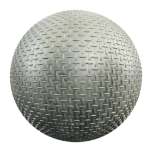</a> <b><a href="DiamondPlate001">Diamond Plate 001</a></b> by ambientCG · <a href="https://ambientcg.com/a/DiamondPlate001">source</a> | <a href="DiamondPlate002">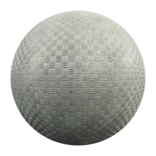</a> <b><a href="DiamondPlate002">Diamond Plate 002</a></b> by ambientCG · <a href="https://ambientcg.com/a/DiamondPlate002">source</a> | <a href="DiamondPlate003">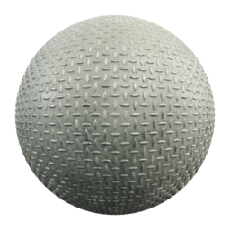</a> <b><a href="DiamondPlate003">Diamond Plate 003</a></b> by ambientCG · <a href="https://ambientcg.com/a/DiamondPlate003">source</a> | <a href="DiamondPlate004">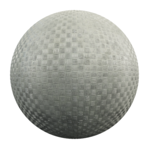</a> <b><a href="DiamondPlate004">Diamond Plate 004</a></b> by ambientCG · <a href="https://ambientcg.com/a/DiamondPlate004">source</a> |
| <a href="DiamondPlate005A">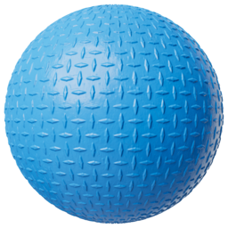</a> <b><a href="DiamondPlate005A">Diamond Plate 005 A</a></b> by ambientCG · <a href="https://ambientcg.com/a/DiamondPlate005A">source</a> | <a href="DiamondPlate005B">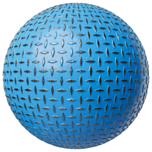</a> <b><a href="DiamondPlate005B">Diamond Plate 005 B</a></b> by ambientCG · <a href="https://ambientcg.com/a/DiamondPlate005B">source</a> | <a href="DiamondPlate005C">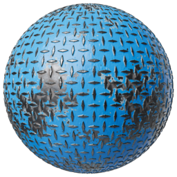</a> <b><a href="DiamondPlate005C">Diamond Plate 005 C</a></b> by ambientCG · <a href="https://ambientcg.com/a/DiamondPlate005C">source</a> | <a href="DiamondPlate005D">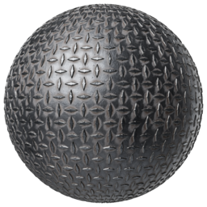</a> <b><a href="DiamondPlate005D">Diamond Plate 005 D</a></b> by ambientCG · <a href="https://ambientcg.com/a/DiamondPlate005D">source</a> |
| <a href="DiamondPlate006A">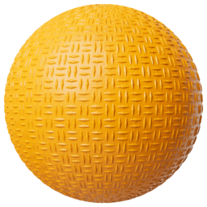</a> <b><a href="DiamondPlate006A">Diamond Plate 006 A</a></b> by ambientCG · <a href="https://ambientcg.com/a/DiamondPlate006A">source</a> | <a href="DiamondPlate006B">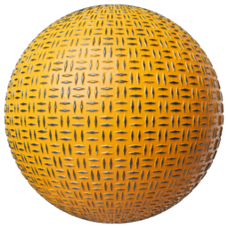</a> <b><a href="DiamondPlate006B">Diamond Plate 006 B</a></b> by ambientCG · <a href="https://ambientcg.com/a/DiamondPlate006B">source</a> | <a href="DiamondPlate006C">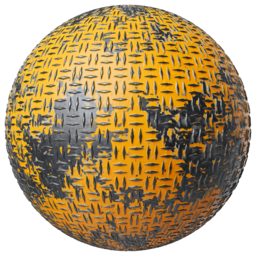</a> <b><a href="DiamondPlate006C">Diamond Plate 006 C</a></b> by ambientCG · <a href="https://ambientcg.com/a/DiamondPlate006C">source</a> | <a href="DiamondPlate006D">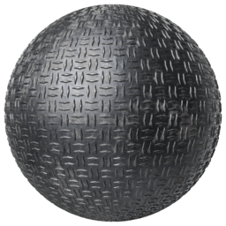</a> <b><a href="DiamondPlate006D">Diamond Plate 006 D</a></b> by ambientCG · <a href="https://ambientcg.com/a/DiamondPlate006D">source</a> |
| <a href="DiamondPlate007A">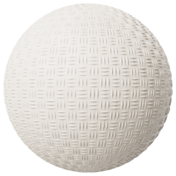</a> <b><a href="DiamondPlate007A">Diamond Plate 007 A</a></b> by ambientCG · <a href="https://ambientcg.com/a/DiamondPlate007A">source</a> | <a href="DiamondPlate007B">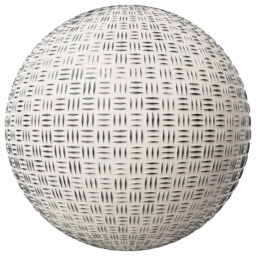</a> <b><a href="DiamondPlate007B">Diamond Plate 007 B</a></b> by ambientCG · <a href="https://ambientcg.com/a/DiamondPlate007B">source</a> | <a href="DiamondPlate007C">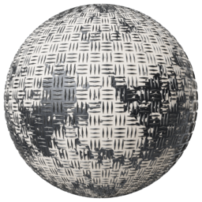</a> <b><a href="DiamondPlate007C">Diamond Plate 007 C</a></b> by ambientCG · <a href="https://ambientcg.com/a/DiamondPlate007C">source</a> | <a href="DiamondPlate007D">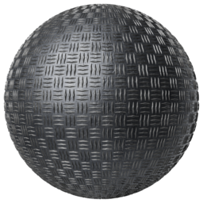</a> <b><a href="DiamondPlate007D">Diamond Plate 007 D</a></b> by ambientCG · <a href="https://ambientcg.com/a/DiamondPlate007D">source</a> |
| <a href="DiamondPlate008A">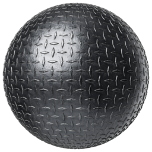</a> <b><a href="DiamondPlate008A">Diamond Plate 008 A</a></b> by ambientCG · <a href="https://ambientcg.com/a/DiamondPlate008A">source</a> | <a href="DiamondPlate008B">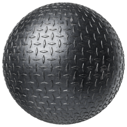</a> <b><a href="DiamondPlate008B">Diamond Plate 008 B</a></b> by ambientCG · <a href="https://ambientcg.com/a/DiamondPlate008B">source</a> | <a href="DiamondPlate008C">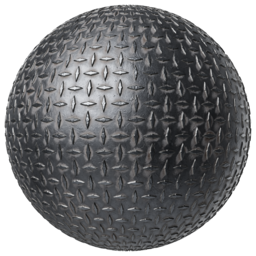</a> <b><a href="DiamondPlate008C">Diamond Plate 008 C</a></b> by ambientCG · <a href="https://ambientcg.com/a/DiamondPlate008C">source</a> | <a href="DiamondPlate008D">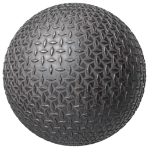</a> <b><a href="DiamondPlate008D">Diamond Plate 008 D</a></b> by ambientCG · <a href="https://ambientcg.com/a/DiamondPlate008D">source</a> |
| <a href="DiamondPlate009">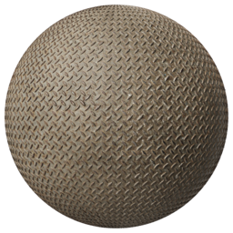</a> <b><a href="DiamondPlate009">Diamond Plate 009</a></b> by ambientCG · <a href="https://ambientcg.com/a/DiamondPlate009">source</a> |  |  |  |

---

Kept up to date by this repository's own [update workflow](.github/workflows/update.yml), with code and plan from [cc0-mirror](https://github.com/zuujis-cc0/cc0-mirror). Something wrong? [Open an issue there](https://github.com/zuujis-cc0/cc0-mirror/issues/new) or use the [private report form](https://games.zuujis.com/report).
